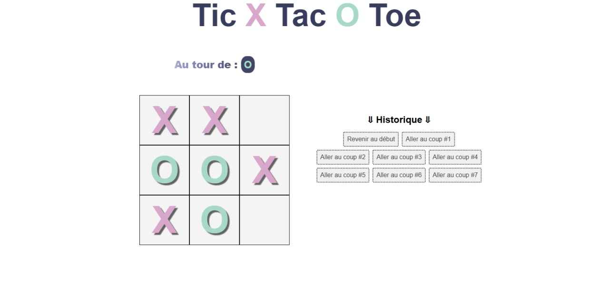

  

## Objectif du projet

Ce projet de jeu du Morpion (Tic-Tac-Toe) m'a permis de m'exercer sur la logique algorithmique et de travailler la structure d'une application interactive dynamique.

### Réalisations techniques

- Création des composants de l'interface : la grille, l'affichage du joueur actif et l'historique des coups joués.
- Gestion des états (calcul des victoires, match nul et réinitialisation).
